# RETRO-Profile

> **Retrieval-Augmented Multiple-Instance Regression for Speaker Age & Height Estimation**
> Reference implementation for the master's thesis _"Age and Height Estimation from Audio"_.

RETRO-Profile combines three ideas borrowed from adjacent sound / vision tasks but never combined for speech-based trait regression:

| # | Component | What it does | Borrowed from |
|---|---|---|---|
| 1 | **MIL Attention Pooling** | Pools a *bag* of utterances per speaker with **per-trait** attention | RL-MIL (Salkhordeh-Ziabari 2024) |
| 2 | **OrdCon Loss** | Forces the embedding space to be ordered along each trait axis | OrdCon (Wang 2025, IEEE TIFS) |
| 3 | **kNN Residual Head** | Predicts via interpolation between training speakers + a small learned residual | Speaker-Smoothed kNN (Li 2024) |

Datasets supported out of the box: **TIMIT**, **NISP**, **HeightCeleb**.

---

## 📋 Table of Contents

1. [TL;DR](#tldr)
2. [The Three Core Novelties](#the-three-core-novelties)
3. [Architecture & Data Flow](#architecture--data-flow)
4. [UML Class Diagrams](#uml-class-diagrams)
5. [Training & Inference Pipelines](#training--inference-pipelines)
6. [Project Structure (File-by-File)](#project-structure-file-by-file)
7. [Configuration System](#configuration-system)
8. [Quick Start](#quick-start)
9. [Plugging in Baselines](#plugging-in-baselines)
10. [Adding a New Dataset](#adding-a-new-dataset)
11. [Reproducing Thesis Numbers](#reproducing-thesis-numbers)
12. [Testing](#testing)
13. [Troubleshooting](#troubleshooting)
14. [References](#references)

---

## TL;DR

```
pip install -e .
python scripts/prepare_timit.py --raw /path/to/timit  --out data/timit
python scripts/train.py experiment=retro_profile_full data=timit
python scripts/build_datastore.py --ckpt runs/<run>/checkpoints/last.ckpt \
    --config-dir runs/<run>/.hydra --output runs/<run>/datastore
python scripts/evaluate.py --ckpt runs/<run>/checkpoints/last.ckpt \
    --config-dir runs/<run>/.hydra --datastore runs/<run>/datastore \
    --eval timit nisp heightceleb --output runs/<run>/eval
```

Ablations: `experiment={no_mil,no_knn,no_ordcon}`. See [Reproducing Thesis Numbers](#reproducing-thesis-numbers).

---

## The Three Core Novelties

### 1. MIL Attention Pooling — *per-target* gated attention

Each speaker has a **bag** of utterances. Standard models mean-pool them, treating every utterance as equally informative. But:

- **Vowel-rich utterances** → reveal vocal tract length → height
- **Sustained voicing** → reveals jitter/shimmer → age

The same speaker bag should be pooled *differently* for the two traits. We allocate a separate stack of gated attention heads per target.

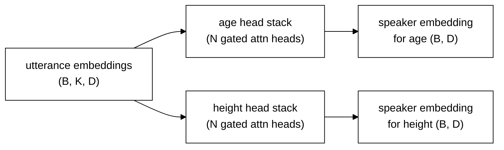

📂 [`src/retro_profile/models/pooling/mil.py`](src/retro_profile/models/pooling/mil.py)

### 2. OrdCon Loss — embedding-space ordering

kNN retrieval only works if the embedding space is *organized along the target axis*. Standard regression doesn't give you that — embeddings can encode anything (accent, channel, content) as long as the head can decode height.

OrdCon enforces:

- **Direction term**: `sign(y_i - y_j) * <z_i - z_j, u> ≥ margin` for every pair, where `u` is a learnable unit direction per target
- **Magnitude term**: `||z_i - z_j|| ∝ |y_i - y_j|`

The result: speakers near each other in embedding space have similar trait values, so kNN retrieves the *right* neighbours.

📂 [`src/retro_profile/losses/ordcon.py`](src/retro_profile/losses/ordcon.py)

### 3. kNN Residual Head — bounded interpolation between real humans

```
ŷ = clamp(label_min, label_max,  anchor(z) + Δ(z))

anchor(z) = Σᵢ softmax(sim(z, zᵢ) / τ) · yᵢ      ← over kNN of z in datastore
Δ(z)      = delta_clip · tanh(MLP(z))             ← small learned residual
```

Instead of an MLP regressing `height ∈ [140, 210]` from scratch (extrapolation), we **retrieve K acoustically-similar training speakers** and take a similarity-weighted mean of their *actual* heights. The MLP only has to predict a small correction (±5 cm) on top.

This converts an open-ended regression problem into bounded interpolation between real observed humans, and makes predictions **forensic-defensible**: every prediction comes with the K speakers that anchored it.

📂 [`src/retro_profile/models/heads/residual.py`](src/retro_profile/models/heads/residual.py) + [`src/retro_profile/retrieval/datastore.py`](src/retro_profile/retrieval/datastore.py)

---

## Architecture & Data Flow

### High-level data flow (forward pass)

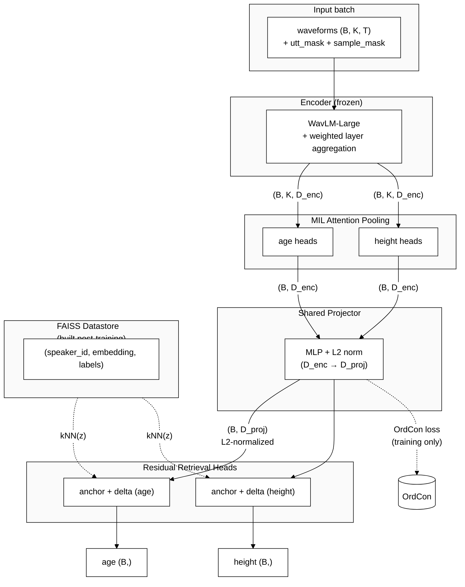

**Key design decisions:**
- The encoder is **frozen** — we only train layer weights, MIL pooling, projector, and heads (~1–3% of params).
- The projector is **shared** across targets — same embedding indexes the same neighbours; different heads read different label columns.
- The datastore is **empty during training**; residual heads degrade to plain MLPs in that case. After training, `build_datastore.py` populates it.

### Component dependency graph

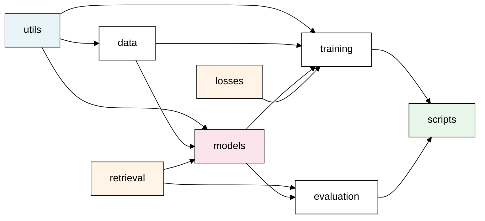

`utils` is the lowest layer. `losses` and `retrieval` are leaves of the dependency graph — they don't depend on `data` or `training`. `scripts` only sits at the top, calling everything.

---

## UML Class Diagrams

### Models

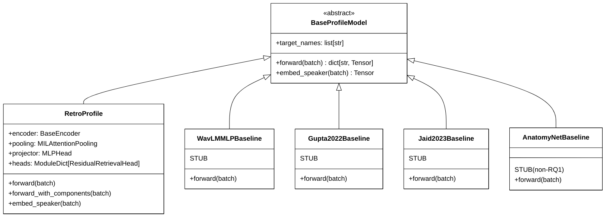

### Encoders

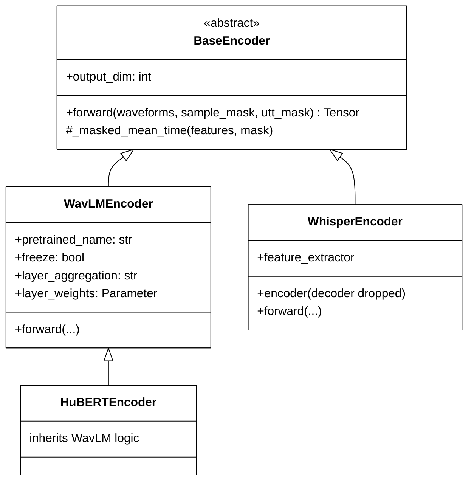

### Pooling

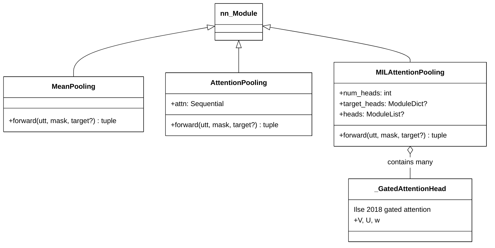

### Heads & Retrieval

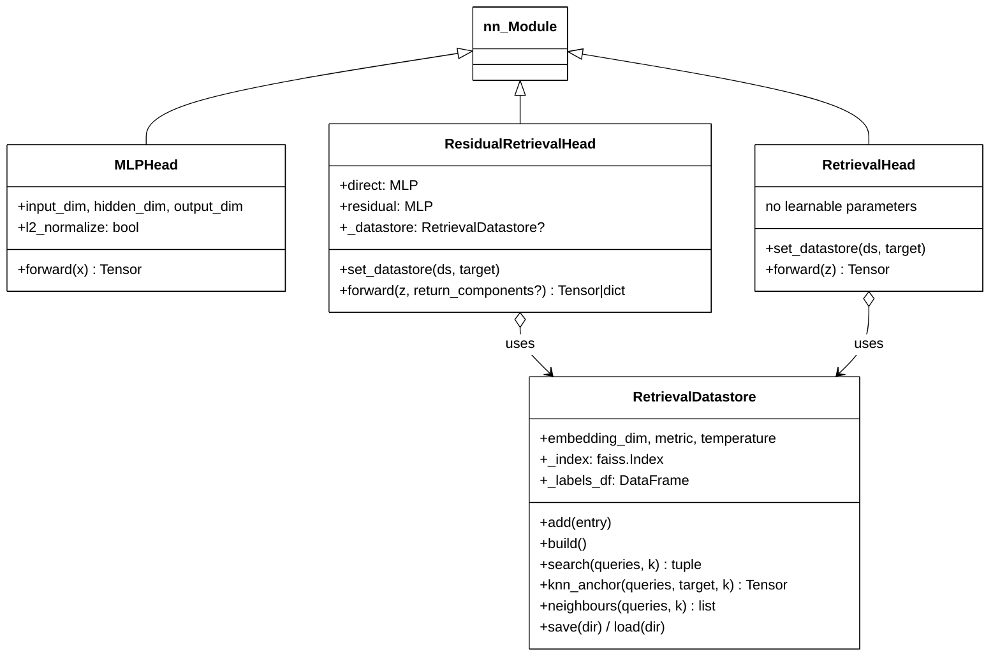

### Losses

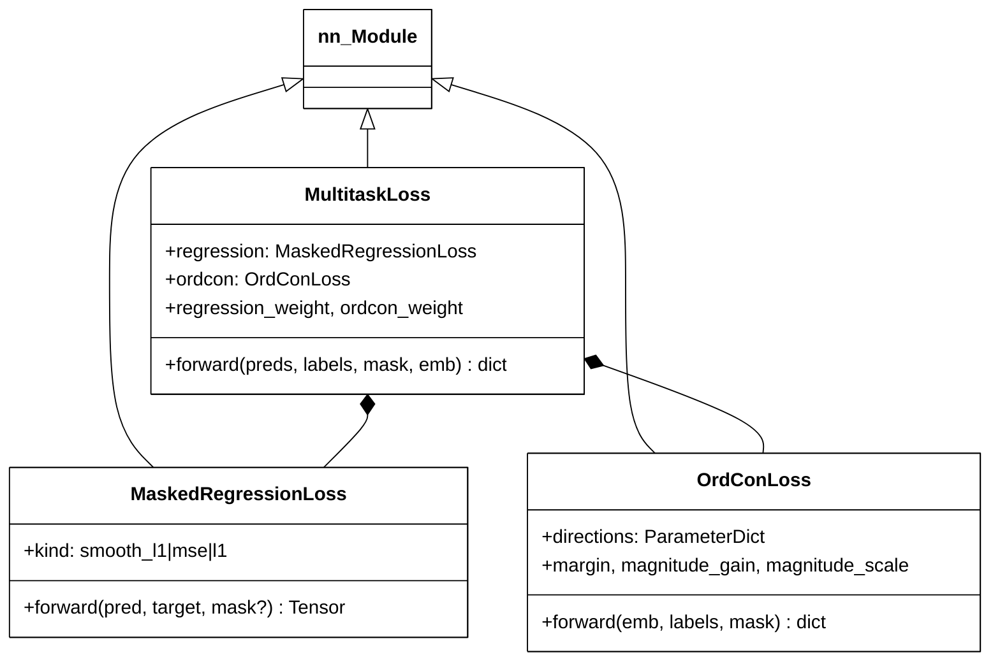

### Data layer

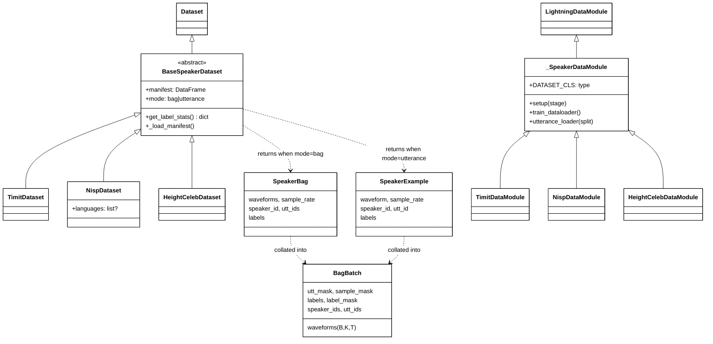

---

## Training & Inference Pipelines

### Training-time sequence

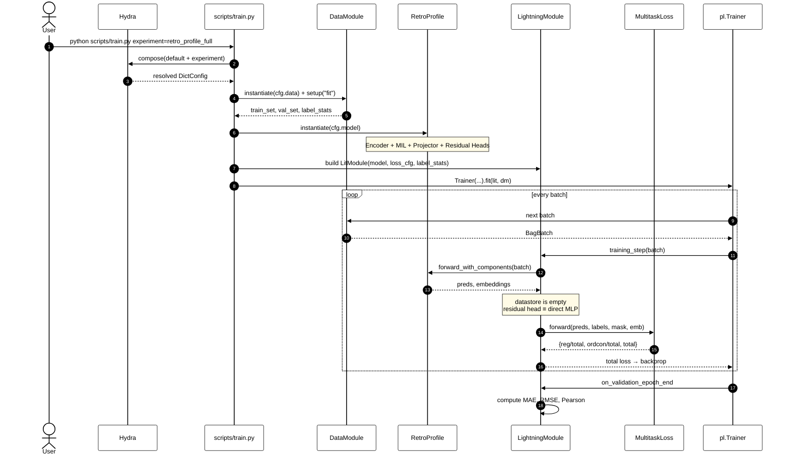

### Inference-time sequence (with datastore)

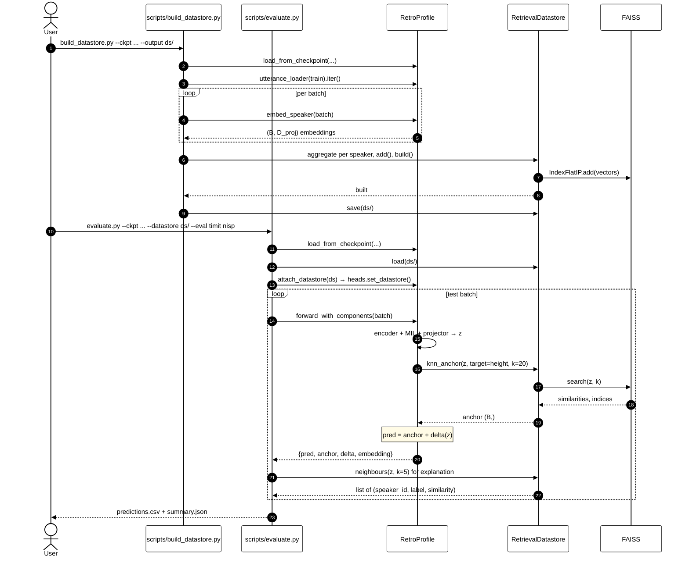

### Datastore lifecycle

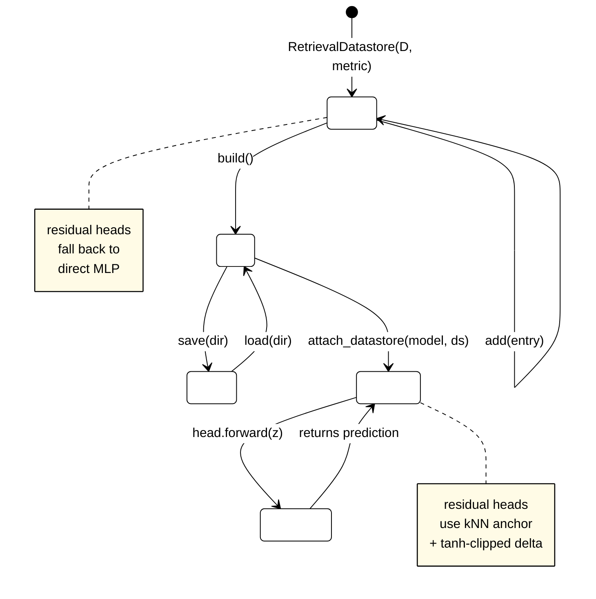

---

## Project Structure (File-by-File)

### 📁 Top-level files
| File | Purpose |
|---|---|
| `README.md` | This document |
| `pyproject.toml` | Modern Python project metadata; `pip install -e .` reads this |
| `requirements.txt` | Pinned versions for bit-stable reproducibility |
| `LICENSE` | MIT |
| `.gitignore` | Standard Python ignores |


### 📁 configs/ — Hydra configuration files
```
configs/
├── default.yaml                    # top-level: composes model + data + training + experiment
├── data/
│   ├── timit.yaml                  # TIMIT DataModule config
│   ├── nisp.yaml                   # NISP DataModule config (with language filter)
│   └── heightceleb.yaml            # HeightCeleb DataModule config (height; age for 573 speakers)
├── model/
│   ├── retro_profile.yaml          # ★ The full RETRO-Profile architecture
│   ├── baseline_wavlm_mlp.yaml     # RQ1 #1 — WavLM + regression MLP (uses stub class)
│   ├── baseline_gupta2022.yaml     # RQ1 #2 — bi-encoder transformer mixture [1] (uses stub class)
│   ├── baseline_jaid2023.yaml      # RQ1 #3 — 1D CNN + filter-bank init [3] (uses stub class)
│   └── baseline_anatomynet.yaml    # supplementary (non-RQ1) — physics-inspired (uses stub class)
├── training/
│   └── default.yaml                # Loss weights, optimizer, scheduler, callbacks
└── experiment/
    ├── retro_profile_full.yaml     # ★ Full RETRO-Profile recipe
    ├── no_mil.yaml                 # Ablation: MIL → mean pooling
    ├── no_knn.yaml                 # Ablation: disable kNN retrieval
    └── no_ordcon.yaml              # Ablation: zero out OrdCon weight
```

**How they compose:** `default.yaml` lists `defaults: [model: retro_profile, data: timit, training: default, experiment: null]`. The optional `experiment=...` override is applied last and can override any sub-field via the `# @package _global_` directive.


### 📁 src/retro_profile/data/ — datasets, augmentation, batching
| File | Lines | Role |
|---|---:|---|
| `__init__.py` | 33 | Re-exports public API |
| `base.py` | 186 | `BaseSpeakerDataset` (abstract) + `SpeakerBag` / `SpeakerExample` dataclasses. Supports two indexing modes: `mode='bag'` (per-speaker) for training, `mode='utterance'` (per-utterance) for datastore building. |
| `timit.py` | 42 | `TimitDataset` — reads `manifests/{train,dev,test}.csv` produced by `prepare_timit.py` |
| `nisp.py` | 46 | `NispDataset` — supports `languages=[hindi, tamil, ...]` filter |
| `heightceleb.py` | 31 | `HeightCelebDataset` — height for all, age for 573 speakers (NaN otherwise); pooled splits like `train+test` |
| `transforms.py` | 115 | `AugmentationPipeline` (noise, narrow speed perturb, time mask, gain jitter) and `NoOpAugmentation` for eval |
| `collate.py` | 119 | **`BagBatch` dataclass** + `collate_bags` / `collate_examples` / `make_collate_fn`. Pads variable bag sizes (`K_max`) and utterance lengths (`T_max`), produces `(B, K_max, T_max)` tensors plus boolean masks. |
| `registry.py` | 178 | `_SpeakerDataModule` (Lightning DataModule base) + `TimitDataModule` / `NispDataModule` / `HeightCelebDataModule`. Also has `utterance_loader()` for the datastore build pass. |

**Why a dual indexing mode?** Training uses bag mode so MIL pooling sees the bag; datastore building uses utterance mode so we average per speaker afterwards.


### 📁 src/retro_profile/models/ — model layer
```
models/
├── __init__.py                     # re-exports everything public
├── base.py                         # ★ BaseProfileModel abstract contract
├── retro_profile.py                # ★ The main RetroProfile model (encoder + MIL + projector + heads)
├── registry.py                     # short-name → class registry for non-Hydra entry points
│
├── encoders/
│   ├── __init__.py
│   ├── base.py                     # BaseEncoder; defines (B,K,T) → (B,K,D) contract
│   ├── wavlm.py                    # ★ WavLM-Large with weighted layer aggregation
│   ├── hubert.py                   # HuBERT (mirrors WavLM API)
│   └── whisper.py                  # Whisper encoder-only (decoder dropped)
│
├── pooling/
│   ├── __init__.py
│   ├── mean.py                     # MeanPooling (baseline; ignores padded utts)
│   ├── attention.py                # AttentionPooling (single-head, ablation)
│   └── mil.py                      # ★★★ MILAttentionPooling — per-target gated multi-head
│
├── heads/
│   ├── __init__.py
│   ├── mlp.py                      # MLPHead (also serves as L2-normalized projector)
│   ├── residual.py                 # ★★★ ResidualRetrievalHead — kNN anchor + tanh-clipped delta
│   └── retrieval.py                # RetrievalHead (pure kNN, no residual; ablation)
│
└── baselines/
    ├── __init__.py
    ├── wavlm_mlp.py                # STUB — WavLM + regression MLP (RQ1 #1)
    ├── gupta2022.py                # STUB — bi-encoder transformer mixture [1] (RQ1 #2)
    ├── jaid2023.py                 # STUB — 1D CNN + filter-bank init [3] (RQ1 #3)
    └── anatomynet.py               # STUB — physics-inspired (supplementary, non-RQ1)
```

**Key files in detail:**

- **`base.py`** — Defines `BaseProfileModel` with three required methods: `target_names`, `forward(batch) → dict[str, Tensor]`, `embed_speaker(batch) → Tensor`. Every model (RETRO-Profile + all baselines) implements this. The trainer, evaluator, and datastore-builder treat them uniformly.

- **`retro_profile.py`** — Wires together encoder + MIL pooling + shared projector + per-target residual heads. Two forward methods:
  - `forward(batch)`: returns `{age: (B,), height: (B,)}`
  - `forward_with_components(batch)`: also returns `embedding`, `attention`, `anchor`, `delta` for losses and explanations
  
  Plus `embed_speaker(batch)` → `(B, D_proj)` for the FAISS datastore.

- **`encoders/wavlm.py`** — Loads HF WavLM-Large; returns per-utterance embeddings via masked mean over time. Optional learnable softmax over all 25 hidden states (the trick that ECAPA-TDNN-WavLM uses). Frozen by default.

- **`pooling/mil.py`** — The MIL novelty. Each `_GatedAttentionHead` implements `score = w · (tanh(V h) ⊙ sigmoid(U h))` from Ilse et al. 2018. `MILAttentionPooling` allocates either a single head stack or a separate stack **per target** (controlled by `target_names`). Outputs averaged across heads to keep the speaker embedding D-dim.

- **`heads/residual.py`** — The retrieval-residual novelty. Holds two MLPs (`direct` and `residual`) plus a reference to a `RetrievalDatastore`. When the datastore is set, predicts `clamp(label_min, label_max, anchor + tanh(MLP(z)) · delta_clip)`. When unset, falls back to `direct(z)`.

- **`baselines/*.py`** — Three placeholder classes that conform to `BaseProfileModel` but raise `NotImplementedError("...is a stub")` in `forward()`. Drop in your implementation; everything else (training, evaluation, datastore) works unchanged.


### 📁 src/retro_profile/retrieval/ — FAISS datastore
| File | Role |
|---|---|
| `datastore.py` | `RetrievalDatastore` — FAISS-backed kNN over per-speaker embeddings + label parquet sidecar. Supports `cosine` and `l2` metrics, `softmax_distance` and `uniform` weighting, `save/load`. Returns both `knn_anchor` (weighted-mean labels) and `neighbours` (full per-query trace for forensic explanations). |
| `builder.py` | `build_datastore(model, dataloader)` — runs the model on the train split, averages per speaker, adds to a fresh datastore. Also `attach_datastore(model, ds)` which calls `set_datastore` on every retrieval-aware head in `model.heads`. |
| `search.py` | `SearchConfig` dataclass — k, metric, weighting, temperature. Used by Hydra configs. |


### 📁 src/retro_profile/losses/ — loss functions
| File | Role |
|---|---|
| `regression.py` | `MaskedRegressionLoss` — smooth-L1 / L1 / MSE that ignores NaN labels (essential for cross-corpus training where HeightCeleb has no age). |
| `ordcon.py` | **`OrdConLoss`** — direction (margin-ranking) + magnitude (||Δz|| ∝ \|Δy\|) terms over pairs in the batch, with one learnable unit direction per target. |
| `multitask.py` | `MultitaskLoss` — weighted sum of regression + OrdCon. Returns a dict so each component is logged separately. |


### 📁 src/retro_profile/training/ — Lightning module + trainer infra
| File | Role |
|---|---|
| `lightning_module.py` | `RetroProfileLitModule` — wraps any `BaseProfileModel` (RetroProfile or any baseline). Handles label normalization (z-score during loss, denormalize for metrics), step/epoch logging, optimizer/scheduler config. |
| `metrics.py` | `RegressionMetrics` — streaming MAE / RMSE / Pearson r per target with NaN-aware masking. |
| `optim.py` | `build_optimizer` (AdamW/Adam/SGD) + `build_scheduler` (warmup-cosine / cosine / none). |
| `callbacks.py` | `LogTrainableParamCount` (frozen-aware) + `PeriodicDatastoreRebuild` (rebuild kNN datastore every N epochs after a warmup). |


### 📁 src/retro_profile/evaluation/ — explainable evaluator
| File | Role |
|---|---|
| `evaluator.py` | `evaluate_with_explanations(model, dataloader, datastore, …)` — runs the model on a test loader and produces a DataFrame with columns `speaker_id, target, prediction, anchor, delta, ground_truth, error, neighbour_<i>_speaker, neighbour_<i>_label, neighbour_<i>_similarity`. This is what the thesis chapter on forensic defensibility uses. |


### 📁 src/retro_profile/utils/ — small infrastructure
| File | Role |
|---|---|
| `audio.py` | `load_audio` (soundfile + torchaudio resample), `random_crop`, `crop_or_pad`, `normalize_loudness`. |
| `config.py` | `load_config` + recursive `instantiate(cfg)` — walks a config tree, instantiates any dict that has `_target_`. Independent of `hydra.utils.instantiate` so unit tests can build models from plain dicts. |
| `logging.py` | `setup_logging(log_dir, level)` + `get_logger(name)` — loguru with sane defaults and PII-safe diagnose=False. |
| `seed.py` | `seed_everything(seed, deterministic=False)` — Python + NumPy + PyTorch CPU/CUDA seeding. |
| `registry.py` | `Registry` — small name→class registry with `.register(key)`, `.build(key, **kwargs)`, etc. |


### 📁 scripts/ — entry points
| Script | What it does |
|---|---|
| `train.py` | Hydra-driven training. Composes config, builds DataModule + model + LitModule, runs `Trainer.fit()` then `Trainer.test()`. Returns the monitored val metric so Hydra sweeps work. |
| `build_datastore.py` | Loads a checkpoint, runs `embed_speaker` over the train split, builds the FAISS index, saves `index.faiss + labels.parquet + meta.json` to disk. |
| `evaluate.py` | Loads checkpoint + (optional) datastore, runs `evaluate_with_explanations` on each requested corpus, writes per-corpus `predictions_<corpus>.csv` and a `summary.json` of MAE/RMSE/Pearson. |
| `prepare_timit.py` | Reads raw TIMIT (`SPKRINFO.TXT` + `TRAIN/`/`TEST/` audio), converts feet/inches → cm, computes age from recording-birth dates, writes `manifests/{train,dev,test}.csv`. |
| `prepare_nisp.py` | Reads raw NISP per-language metadata + audio tree, joins on speaker, writes manifests with language column. |
| `prepare_heightceleb.py` | Reads `heights.csv` + `audio/<spk>/*.wav`, joins, writes manifests. |


### 📁 tests/ — pytest suite
| File | Tests |
|---|---|
| `conftest.py` | `fake_bag_batch` fixture — synthetic batch of 3 speakers × ≤4 utts × ≤2400 samples |
| `test_data.py` | Collate shape/mask/label correctness, NaN handling, padding |
| `test_pooling.py` | Mean / attention / MIL pooling: mask handling, per-target distinct outputs, attention sums to 1 |
| `test_losses.py` | Regression NaN masking, OrdCon zero-on-perfect-order property, OrdCon positive-on-anti-correlated |
| `test_retrieval.py` | FAISS datastore: shapes, self-search, uniform weighting matches mean, save/load roundtrip |
| `test_heads.py` | ResidualRetrievalHead: fallback when no datastore, anchor+delta when datastore set, delta clipping |
| `test_model.py` | Full RetroProfile forward smoke test with a tiny stub encoder, `embed_speaker` returns L2-normalized output |
| `test_utils.py` | Registry register/build/duplicate, recursive `instantiate` |

**30 tests, all passing.** Run with `pytest tests/`.


### 📁 docs/ — design docs
| File | Content |
|---|---|
| `architecture.md` | Deep-dive on the architecture, component responsibilities, and design rationale. |
| `training.md` | Hardware/memory tips, hyperparameter notes, two-phase training curriculum, logging. |
| `datasets.md` | Manifest format, expected raw layouts for TIMIT/NISP/HeightCeleb, NaN-label cross-corpus behaviour. |


---

## Configuration System

The codebase uses **Hydra** for hierarchical config composition. The flow:

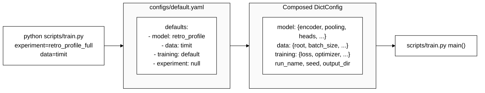

**Anatomy of `configs/model/retro_profile.yaml`** (abbreviated):

```
_target_: retro_profile.models.RetroProfile
encoder:
  _target_: retro_profile.models.WavLMEncoder
  pretrained_name: microsoft/wavlm-large
  freeze: true
pooling:
  _target_: retro_profile.models.MILAttentionPooling
  num_heads: 4
  target_names: [age, height]
heads:
  age:
    _target_: retro_profile.models.ResidualRetrievalHead
    label_min: 18.0
    label_max: 80.0
  height:
    _target_: retro_profile.models.ResidualRetrievalHead
    label_min: 140.0
    label_max: 210.0
projector:
  _target_: retro_profile.models.MLPHead
  l2_normalize: true
```

Our recursive `instantiate()` in `utils/config.py` walks this tree and constructs every `_target_`-bearing dict. So you can swap any component by changing one YAML line:

```
# Swap encoder
python scripts/train.py model.encoder._target_=retro_profile.models.HuBERTEncoder

# Swap pooling
python scripts/train.py model.pooling._target_=retro_profile.models.MeanPooling

# Bump bag size
python scripts/train.py data.bag_size=16 data.batch_size=8

# Sweep over OrdCon weights (Hydra multirun)
python scripts/train.py -m training.loss.ordcon_weight=0.0,0.1,0.3,0.5,1.0
```

---

## Quick Start

### 1. Install

```
git clone <repo>
cd retro-profile
pip install -e .
# or, for pinned versions:
pip install -r requirements.txt
pip install -e . --no-deps
```

### 2. Prepare data

```
python scripts/prepare_timit.py        --raw /data/timit/raw       --out data/timit
python scripts/prepare_nisp.py         --raw /data/nisp/raw        --out data/nisp
python scripts/prepare_heightceleb.py  --raw /data/heightceleb/raw --out data/heightceleb
```

Each writes `manifests/{train,dev,test}.csv` under `--out`.

### 3. Train

```
python scripts/train.py experiment=retro_profile_full data=timit
```

Outputs go to `runs/<run_name>/`. Watch progress with:

```
tensorboard --logdir runs/
```

### 4. Build the kNN datastore

```
python scripts/build_datastore.py \
  --ckpt      runs/<run_name>/checkpoints/last.ckpt \
  --config-dir runs/<run_name>/.hydra \
  --output    runs/<run_name>/datastore
```

### 5. Evaluate

```
python scripts/evaluate.py \
  --ckpt        runs/<run_name>/checkpoints/last.ckpt \
  --config-dir  runs/<run_name>/.hydra \
  --datastore   runs/<run_name>/datastore \
  --eval        timit nisp heightceleb \
  --output      runs/<run_name>/eval
```

Produces:
- `predictions_<corpus>.csv` — per-speaker predictions with anchor / delta / kNN neighbours
- `summary.json` — MAE / RMSE / Pearson per target per corpus

---

## Plugging in Baselines

The three RQ1 comparison systems from the proposal (§4.5) are: **WavLM + regression MLP** (`wavlm_mlp.py`), the **bi-encoder transformer mixture** from Gupta et al. 2022 [1] (`gupta2022.py`), and the **1D CNN with filter-bank initialization** from Jaid & Abdulhassan 2023 [3] (`jaid2023.py`). A fourth, **supplementary (non-RQ1)** stub, `anatomynet.py`, is kept for the redundancy comparison. All are **stubs** with the right signature. Each raises `NotImplementedError("...is a stub")` so you cannot accidentally train on a no-op model.

To implement, e.g., the WavLM + MLP baseline:

```
# src/retro_profile/models/baselines/wavlm_mlp.py

class WavLMMLPBaseline(BaseProfileModel):
    def __init__(self, encoder, target_names=None, hidden_dim=256, **kwargs):
        super().__init__(target_names=target_names or ["age", "height"])
        self.encoder = encoder
        D = encoder.output_dim
        # ✅ Add your heads
        self.heads = nn.ModuleDict({
            t: nn.Sequential(nn.Linear(D, hidden_dim), nn.GELU(),
                             nn.Linear(hidden_dim, 1))
            for t in self.target_names
        })

    def forward(self, batch):
        # ✅ Implement the forward pass
        utt = self.encoder(batch.waveforms, batch.sample_mask, batch.utt_mask)
        # mean over time AND over utterances
        m = batch.utt_mask.to(utt.dtype).unsqueeze(-1)
        speaker_emb = (utt * m).sum(1) / m.sum(1).clamp_min(1.0)
        return {t: head(speaker_emb).squeeze(-1) for t, head in self.heads.items()}
```

Then train with: `python scripts/train.py model=baseline_wavlm_mlp data=timit`. **No changes to the trainer / evaluator / datastore are needed** — the contract is uniform.

---

## Adding a New Dataset

1. **Add a `prepare_<corpus>.py`** in `scripts/` that writes `manifests/{train,dev,test}.csv` with at minimum: `speaker_id, utt_id, audio_path, <target columns>`.

2. **Subclass `BaseSpeakerDataset`** in `src/retro_profile/data/<corpus>.py`:
   ```
   class MyCorpusDataset(BaseSpeakerDataset):
       SPLIT_FILE = {"train": "train.csv", "dev": "dev.csv", "test": "test.csv"}
       def _load_manifest(self):
           df = pd.read_csv(self.root / "manifests" / self.SPLIT_FILE[self.split])
           df["audio_path"] = df["audio_path"].apply(
               lambda p: str(self.root / p) if not Path(p).is_absolute() else p)
           return df
   ```

3. **Register a DataModule** in `src/retro_profile/data/registry.py`:
   ```
   @datamodules.register("mycorpus")
   class MyCorpusDataModule(_SpeakerDataModule):
       DATASET_CLS = MyCorpusDataset
   ```

4. **Add a config** at `configs/data/mycorpus.yaml` mirroring `configs/data/timit.yaml`.

5. Train with `python scripts/train.py data=mycorpus`.

---

## Reproducing Thesis Numbers

The proposal targets these numbers (TIMIT test split, MAE):

| Method | Age (yrs) | Height M (cm) | Height F (cm) |
|---|---|---|---|
| Truong 2022 SOTA | 4.01 | 5.18 | 4.91 |
| **RETRO-Profile (conservative)** | **3.4–3.7** | **4.0–4.5** | **3.8–4.2** |
| RETRO-Profile (optimistic) | 3.0–3.3 | 3.5–4.0 | 3.3–3.7 |

**Recommended order of runs:**

```
# 1. No-MIL ablation (mean pooling baseline)
python scripts/train.py experiment=no_mil data=timit

# 2. No-OrdCon ablation (regression only)
python scripts/train.py experiment=no_ordcon data=timit

# 3. No-kNN ablation (MIL + OrdCon, no retrieval)
python scripts/train.py experiment=no_knn data=timit

# 4. Full RETRO-Profile
python scripts/train.py experiment=retro_profile_full data=timit

# 5. Build datastore + evaluate cross-corpus
python scripts/build_datastore.py --ckpt runs/<full>/checkpoints/last.ckpt \
    --config-dir runs/<full>/.hydra --output runs/<full>/datastore
python scripts/evaluate.py --ckpt runs/<full>/checkpoints/last.ckpt \
    --config-dir runs/<full>/.hydra --datastore runs/<full>/datastore \
    --eval timit nisp heightceleb --output runs/<full>/eval
```

The cross-corpus drop in step 5 is the headline result — RETRO-Profile should show a markedly smaller drop in MAE going from TIMIT-test to NISP/HeightCeleb than any of the ablations.

---

## Testing

```
pytest tests/                                # full suite (30 tests, ~0.2 s)
pytest tests/test_pooling.py -v              # MIL / mean / attention pooling
pytest tests/test_losses.py::test_ordcon_zero_when_already_perfectly_ordered -v
pytest tests/ --tb=short                     # short tracebacks
```

The suite tests the **core novelties** specifically: the property tests in `test_losses.py` verify that OrdCon is zero when embeddings are perfectly ordered along the target axis (the spec) and positive when anti-correlated; `test_pooling.py` verifies that MIL's per-target heads produce **distinct** speaker embeddings; `test_heads.py` verifies the residual head's clipping invariants.

---

## Troubleshooting

#### "FileNotFoundError: TIMIT manifest not found"
You haven't run `scripts/prepare_timit.py` yet, or its `--out` doesn't match `data.root` in your config. The dataset class expects `<root>/manifests/<split>.csv`.


#### OOM during training
In order of impact:
1. Reduce `data.bag_size` (e.g. 8 → 4)
2. Reduce `data.batch_size`
3. Set `model.encoder.freeze: true` (default)
4. Use `precision: 16-mixed` (default on Ampere+)


#### "faiss is required for RetrievalDatastore"
```
pip install faiss-cpu              # CPU
pip install faiss-gpu              # CUDA (if it builds in your env)
```


#### Predictions are stuck at `label_min`
Likely the model is untrained or under-trained. The residual MLP outputs ~0 at random init, and the `direct` MLP output gets clamped. Train for at least 20 epochs.


#### kNN anchors are nonsense
The embedding space hasn't been organized by OrdCon yet. Three causes:
1. `ordcon_weight` is too low (default 0.3 is good)
2. The datastore was built before training converged — rebuild after training
3. The projector isn't L2-normalized (check `model.projector.l2_normalize: true` and `retrieval.metric: cosine`)


#### Want to unfreeze WavLM
Set `model.encoder.freeze: false`, but expect ~3× memory and only marginal gains on TIMIT-scale data. Better to train MIL pooling + projector + heads with the encoder frozen first, then unfreeze the top 2 transformer layers for the last 10 epochs.


---

## References

- **WavLM**: Chen et al. 2022. *"WavLM: Large-Scale Self-Supervised Pre-Training for Full Stack Speech Processing"*. IEEE JSTSP.
- **Truong 2022 (baseline)**: *"Speaker Age and Height Estimation via Self-Supervised Speech Models"*. Interspeech 2022.
- **Kalluri 2019 (baseline)**: *"Automatic Speaker Profiling from Short Duration Speech Data"*.
- **MIL Gated Attention**: Ilse, Tomczak, Welling 2018. *"Attention-based Deep Multiple Instance Learning"*. ICML.
- **RL-MIL**: Salkhordeh-Ziabari et al. 2024. MIL with RL for speaker attribute prediction.
- **OrdCon**: Wang et al. 2025. *"Order-Enhanced Contrastive Learning for Face Age Estimation"*. IEEE TIFS.
- **Speaker-Smoothed kNN**: Li et al. 2024. *"Speaker-Smoothed kNN Speaker Adaptation for End-to-End ASR"*.
- **TIMIT**: Garofolo et al. 1993. NIST.
- **NISP**: Kalluri et al. 2021. *"NISP: A Multi-lingual Multi-accent Dataset for Speaker Profiling"*.
- **HeightCeleb**: Recent VoxCeleb-derived height-labeled corpus.

---

## License

MIT. Speech corpora retain their own licenses — TIMIT (LDC), NISP, HeightCeleb each have their own terms; this repo provides only code, not data.
